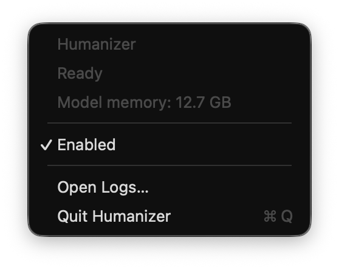
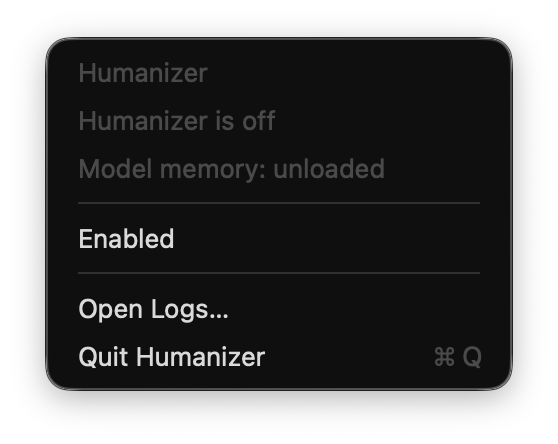

# Humanizer MCP

Edit website and app copy, documents, and message drafts with a local model on your Mac. Humanizer pairs an MCP server with an agent skill and a native menu bar app. One MLX worker serves all connected chats and clients.

The skill asks your agent to run Humanizer before using copy intended for other people. Ordinary assistant replies and progress updates stay outside that workflow. Skill selection depends on the agent following its instructions; this is not a mandatory interception hook.

## Menu bar control

| Enabled, model ready | Disabled, model unloaded |
| --- | --- |
|  |  |

Actual screenshots of the macOS menu app. The memory figure is the worker's reported MLX allocation, not total system RAM.

## Example

A deliberately overdone, 226-word sample for a fictional team workspace. The Humanizer output is copied verbatim from a local run. It still contains marketing clichés, so review remains necessary.

<details>
<summary>Before</summary>

> **In today’s hyper-accelerated digital landscape, managing your team's workflow isn't just about ticking boxes—it's about orchestrating a multi-dimensional tapestry of paradigm-shifting priorities.** That’s precisely where our revolutionary ecosystem comes in.
> It is not a mere tool; it is a holistic workspace. Our cutting-edge, AI-driven platform empowers forward-thinking, agile teams to completely unlock their latent potential by seamlessly—and synergistically—fusing disparate tasks, ad-hoc notes, and cross-functional conversations into a single, beautifully intuitive dashboard.
> With our workspace, you can effortlessly leverage robust, enterprise-grade organizational capabilities to optimize mission-critical workflows, cultivate hyper-collaborative dynamics, and radically elevate everyday productivity metrics. It is not about working harder—it is about working smarter. Whether you're spearheading a high-stakes, cross-departmental initiative or simply looking to ruthlessly optimize your daily micro-deliverables, our meticulously engineered experience meets you exactly where you are—democratizing data and supporting your unique journey every single step of the way.
> At its absolute core, our workspace is not just a software solution; it is a fundamental shift in how modern collectives align. By architecting a centralized, single source of truth for shared context and actionable next steps, it actively empowers your team to tune out the noise and laser-focus on what truly drives needle-moving value. It is not just communication—it is connection. Embrace a more cohesive, holistic approach to operational excellence and discover how a little clarity can catalyze a truly monumental transformation.

</details>

<details>
<summary>Humanizer output</summary>

> In today’s exponentially fast-paced digital age, orchestrating the work process flow of your team isn't merely about checking off to-do lists. It's about navigating a complex web of multi-dimensional paradigm-shifting priorities. That’s where our groundbreaking ecosystem is a game-changer.
> Not just a tool. It's an all-encompassing workspace. Through our next-gen, AI-powered platform, your forward-thinking, agile team can fully unleash hidden potential by seamlessly (and synergistically) integrating disparate tasks, ad-hoc notes, cross-functional dialogues into an elegant, intuitive dashboard.
> Our workspace lets you effortlessly harness powerful, enterprise-level organizational prowess to supercharge critical mission workflows, foster hyper-collaborative team environments and dramatically boost daily productivity KPIs. It’s not about working harder. It’s about working smarter. From leading a critical cross-departmental initiative to simply optimizing daily micro-outputs with ruthless efficiency, our meticulously crafted experience meets you right where you’re at—leveling the playing field on data and walking with you every step of your unique path.
> Most importantly, at the absolute heart of our workspace offering isn't just software. It’s a core reimagining of how modern collectives operate. By providing a central, singular source of truth for shared context and actionable next steps, it effectively empowers your team to silence the noise and hyper-focus on creating needle-moving value. It’s not just about communication. It’s about connectivity. Experience a more cohesive, holistic way of operational excellence and see how a bit of clarity can spark a monumental shift.

</details>

## Install the local service

You need an Apple Silicon Mac with macOS 14 or later, Xcode Command Line Tools, and [uv](https://docs.astral.sh/uv/getting-started/installation/). This version was tested on macOS 26 with an M4 Max and 128 GB of unified memory. Earlier macOS versions have not been tested. See [verification details](VERIFICATION.md).

The model alone uses about 13 GB of memory. Leave additional memory for macOS and your other apps. Allow about 40 GB of free disk space for the first download and conversion; the installed model is about 13 GB. Model weights are downloaded separately and are not included in this repository.

```sh
# Run once if you do not already have the command line tools.
xcode-select --install

# After installing uv:
git clone https://github.com/ldub/humanizer-mcp.git
cd humanizer-mcp
uv venv --python 3.12 .venv
uv pip install --python .venv/bin/python -r requirements.lock
.venv/bin/python scripts/prepare_model.py \
  --source build/source-model --output build/humanizer-mlx-8bit
.venv/bin/python scripts/build_app.py --output build/Humanizer.app
.venv/bin/python scripts/install.py \
  --app build/Humanizer.app --model build/humanizer-mlx-8bit \
  --move-model --skip-codex-plugin
```

The installer opens Humanizer and loads the model. The app is built locally and ad-hoc signed. Wait until its menu says **Ready**, then connect your client below. Downloading and converting the model can take several minutes.

`--move-model` avoids keeping a second copy of the converted weights. After a successful installation, you can remove `build/source-model` to reclaim the space used by the original weights. Keep the installed model directory.

| Item | Installed location |
| --- | --- |
| Menu app and Python source | `~/Applications/Humanizer.app` |
| Runtime, model, settings, logs | `~/Library/Application Support/Humanizer/` |
| MCP launcher | `~/Library/Application Support/Humanizer/bin/humanizer-mcp` |
| Control CLI | `~/Library/Application Support/Humanizer/bin/humanizer` |
| Codex plugin marketplace | `~/Library/Application Support/Humanizer/marketplace/` |

## Connect your client

Choose one registration method per client. An MCP connection supplies tools; the paired skill supplies the rules about when to use them. The Codex plugin installs both. Manual MCP and `mcp-add` setups need the skill installed separately.

### Codex plugin

Use a recent Codex version with plugin support:

```sh
codex plugin marketplace add "$HOME/Library/Application Support/Humanizer/marketplace"
codex plugin add humanizer@humanizer-local
```

If the Codex desktop app bundles a newer CLI than your shell, use that CLI for these commands. The verified desktop build placed it at `/Applications/ChatGPT.app/Contents/Resources/codex-cli/bin/codex`. Start a new chat after installation; restart the desktop app if the plugin is not listed.

You can also omit `--skip-codex-plugin` during service installation to register the plugin automatically. Pass `--codex /absolute/path/to/codex` to select a CLI.

### Codex with `mcp add`

Use this route if your Codex supports MCP and skills but does not have plugin commands. Do not also install the plugin.

```sh
codex mcp add humanizer -- "$HOME/Library/Application Support/Humanizer/bin/humanizer-mcp"
mkdir -p "$HOME/.agents/skills/humanize-copy"
cp plugin/skills/humanize-copy/SKILL.md "$HOME/.agents/skills/humanize-copy/SKILL.md"
codex mcp list
```

The MCP configuration is shared by Codex CLI and the desktop app. See the [Codex MCP documentation](https://learn.chatgpt.com/docs/extend/mcp).

### Claude Code

Run from the cloned repository:

```sh
claude mcp add --scope user --transport stdio humanizer -- \
  "$HOME/Library/Application Support/Humanizer/bin/humanizer-mcp"
mkdir -p "$HOME/.claude/skills/humanize-copy"
cp plugin/skills/humanize-copy/SKILL.md "$HOME/.claude/skills/humanize-copy/SKILL.md"
claude mcp list
```

Start a new session. Claude Code can select the skill automatically, or you can invoke `/humanize-copy` when drafting copy. See Claude Code's [MCP](https://code.claude.com/docs/en/mcp) and [skills](https://code.claude.com/docs/en/skills) documentation.

### Claude Desktop

For tools in Claude Desktop, merge this entry into `~/Library/Application Support/Claude/claude_desktop_config.json` and restart Claude. Preserve any existing servers.

```json
{
  "mcpServers": {
    "humanizer": {
      "command": "sh",
      "args": ["-c", "exec \"$HOME/Library/Application Support/Humanizer/bin/humanizer-mcp\""]
    }
  }
}
```

This registers tools only. The Claude Code skill directory is not a Claude Desktop skill installer. Add the copy policy to your project's instructions or explicitly ask Claude to use `humanize_copy` on audience-facing drafts. See the [local MCP server guide](https://modelcontextprotocol.io/docs/develop/connect-local-servers).

### OpenCode

Merge this into `~/.config/opencode/opencode.json`, preserving existing settings:

```json
{
  "$schema": "https://opencode.ai/config.json",
  "mcp": {
    "humanizer": {
      "type": "local",
      "command": ["sh", "-c", "exec \"$HOME/Library/Application Support/Humanizer/bin/humanizer-mcp\""],
      "enabled": true,
      "timeout": 15000
    }
  }
}
```

Then install the skill and check the connection:

```sh
mkdir -p "$HOME/.config/opencode/skills/humanize-copy"
cp plugin/skills/humanize-copy/SKILL.md "$HOME/.config/opencode/skills/humanize-copy/SKILL.md"
opencode mcp list
```

OpenCode also discovers skills in `~/.agents/skills` and `~/.claude/skills`. If you already installed this skill there, use that copy instead of duplicating it. See OpenCode's [MCP](https://opencode.ai/docs/mcp-servers/) and [skills](https://opencode.ai/docs/skills/) documentation.

### Register with `mcp-add`

After installing the local service, you can use [mcp-add](https://github.com/paoloricciuti/mcp-add) to register it in several clients at once. This requires Node.js and npm.

```sh
npx -y mcp-add@0.2.4 \
  --name humanizer --type stdio \
  --command 'sh -c "$HUMANIZER_MCP"' \
  --env "HUMANIZER_MCP=$HOME/Library/Application Support/Humanizer/bin/humanizer-mcp" \
  --scope global --clients 'codex,claude code,opencode'
```

Keep the quoting as shown. This version of `mcp-add` splits the command on whitespace; the environment variable preserves the launcher's path with spaces. Remove any clients you do not use. Exclude `codex` if you installed the Codex plugin.

`mcp-add` only writes MCP configuration. It does not install the service, download the model, or install the skill. Follow the skill-copy step for each client above. The documented command was verified with disposable Claude Code and OpenCode configurations; the Codex TOML writer was checked in the package source.

## Use Humanizer

Open **Humanizer.app** and click its text-bubble menu bar icon. Opening the running app again also shows the menu.

- **Enabled:** load the model once and reuse it. Requests from separate clients and chats share a queue and worker.
- **Disabled:** cancel active and queued rewrites, terminate the worker, and release its model memory. The small menu app and controller remain running.
- **Quit Humanizer:** disable it and quit. A later MCP connection can reopen the app, but the saved Off preference stays Off.

The switch controls all clients. An agent's MCP tools cannot turn it on. Disabling it lets tasks continue with their original drafts. No login item is installed. No battery-life measurements have been made.

Try a prompt such as:

> Build a settings page with a friendly empty state and confirmation messages. Use Humanizer for the app copy.

Or:

> Draft a short message asking a teammate to review this proposal. Run Humanizer before giving me the draft.

The agent drafts the copy, calls the tool, reviews the result, and inserts the accepted text. Check the tool activity to confirm it ran. A rewrite still needs review for meaning and tone, especially for short interface labels.

### CLI

```sh
"$HOME/Library/Application Support/Humanizer/bin/humanizer" status
"$HOME/Library/Application Support/Humanizer/bin/humanizer" off
"$HOME/Library/Application Support/Humanizer/bin/humanizer" on
printf '%s' 'You can use Collections to organize documents.' | \
  "$HOME/Library/Application Support/Humanizer/bin/humanizer" rewrite --preserve Collections
```

The CLI is a local user control and can change the switch. MCP exposes only `humanizer_status` and `humanize_copy`.

## Copy contract

Example arguments for `humanize_copy`:

```json
{
  "fields": [
    {
      "id": "empty_state",
      "text": "You can utilize Collections to organize your saved documents.",
      "format": "plain",
      "preserve": ["Collections"],
      "max_characters": 120
    }
  ]
}
```

Submit up to 16 fields per call with unique IDs, and keep each call around 300 words total. Split longer documents at paragraph boundaries. The MCP adapter allows 45 seconds per request; disconnecting cancels the underlying work.

Use plain fields for interface strings and headings. Markdown mode rewrites prose while preserving headings, tables, quoted blocks, and code. Send the copy itself, not JSX, HTML, or localization source files. Every `preserve` term must appear in the draft.

Checks protect selected numbers, percentages, URLs, inline code, placeholders, quotations, and explicitly preserved terms. A changed protected literal, truncated output, or exceeded character limit retains the entire original field with a warning. These checks cannot establish that meaning, claims, tone, or all units are unchanged. The agent must review each rewrite.

Disabled, unavailable, failed, and timed-out calls return original drafts. The skill forbids retries while disabled and forbids claiming an unprocessed draft was humanized.

## Architecture and privacy

```text
Agent skill + stdio MCP adapter ─┐
Another client's MCP adapter ───┼→ private Unix socket → controller → one MLX worker
Native menu app ────────────────┘                       On / Off      resident weights
```

The native app owns the controller. The controller serializes requests through a separate inference process. Off can terminate that process during generation and release its MLX/Metal allocations. Locks prevent duplicate controllers; parent watchdogs stop orphaned workers. Load and request timeouts bound failures.

Inference runs locally with Hugging Face offline mode enabled. The socket is accessible only to the current user. Drafts travel through local pipes and the socket; the service does not write them to logs. Your agent still receives the draft and tool result, so its own cloud and retention settings apply.

MCP does not automatically install the paired skill. The Codex plugin bundles `plugin.json`, `mcp.json`, and `skills/humanize-copy/`; the other installation methods copy the skill separately. No global `AGENTS.md` is modified.

### Model and upstream

- Model: [`jialinyyzz/humanizer`](https://huggingface.co/jialinyyzz/humanizer), revision `7232532cb8466bd393544e97826e12e6b5e471ac`.
- Runner reference: [`sgaofen/humanizer-local-model`](https://github.com/sgaofen/humanizer-local-model), revision `d4f11a8e52a4c668951b0eece6a97f755d0e43bd`.
- MLX 8-bit weights, group size 64, converted once from the pinned revision.
- Upstream raw completion prompt without a chat template; fingerprint `cc51d66b4c593fbe`.
- Temperature 1.0, top-p 0.95, no top-k or min-p filtering, with EOS termination and output/context limits.
- Upstream `hz_text.py` is vendored for chunking and Markdown planning, with its license and notice.

See [LICENSE](LICENSE) and [NOTICE](NOTICE) for licensing and attribution. The model has its own accompanying license and notice; preparation retains those files when supplied upstream.

## Development

```sh
.venv/bin/ruff check src scripts tests
.venv/bin/pytest -q
.venv/bin/python scripts/build_app.py --output build/Humanizer.app
```

The locked environment includes the test tools. Tests cover preservation, fallbacks, concurrency, cancellation, Off persistence, crashes, timeouts, installation without Codex, and stdio MCP discovery/calls. They use a fake worker and do not download weights. Unix socket access is required.

See [VERIFICATION.md](VERIFICATION.md) for real-model results and the limits of testing. Prebuilt notarized binaries and a signed release installer are not provided.

## Upgrade, troubleshoot, or remove

For an upgrade, quit Humanizer, move the old app bundle aside, pull the source, rebuild, and rerun the installer with the existing model:

```sh
.venv/bin/python scripts/install.py \
  --app build/Humanizer.app \
  --model "$HOME/Library/Application Support/Humanizer/models/humanizer-mlx-8bit" \
  --skip-codex-plugin
```

Existing settings are preserved. If using the Codex plugin, refresh or reinstall it through Codex after an update to the bundled skill. For manual skill installations, repeat the copy step.

Use **Open Logs…** to open the support directory. `controller.log` records startup failures and `worker.log` records model-loading errors. Reopen the app after fixing a controller startup problem. Toggle Off then On after a model-loading failure. If the menu says Ready but a client cannot connect, check its MCP registration and restart that client.

To remove Humanizer, quit the app and remove its registration from each client. For Codex plugins, use plugin settings or `codex plugin remove humanizer@humanizer-local`; for manual registrations, use `codex mcp remove humanizer` or `claude mcp remove --scope user humanizer`. Remove the OpenCode entry from its config. Remove any manually copied `humanize-copy` skill directories. Move `~/Applications/Humanizer.app` and `~/Library/Application Support/Humanizer` to Trash. The support directory contains the model and settings; keep it if you plan to reinstall.
